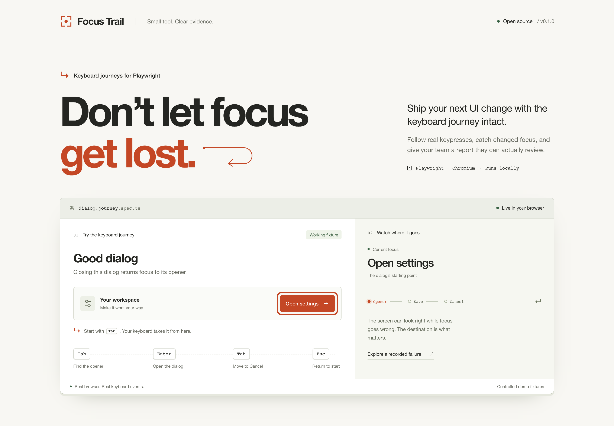
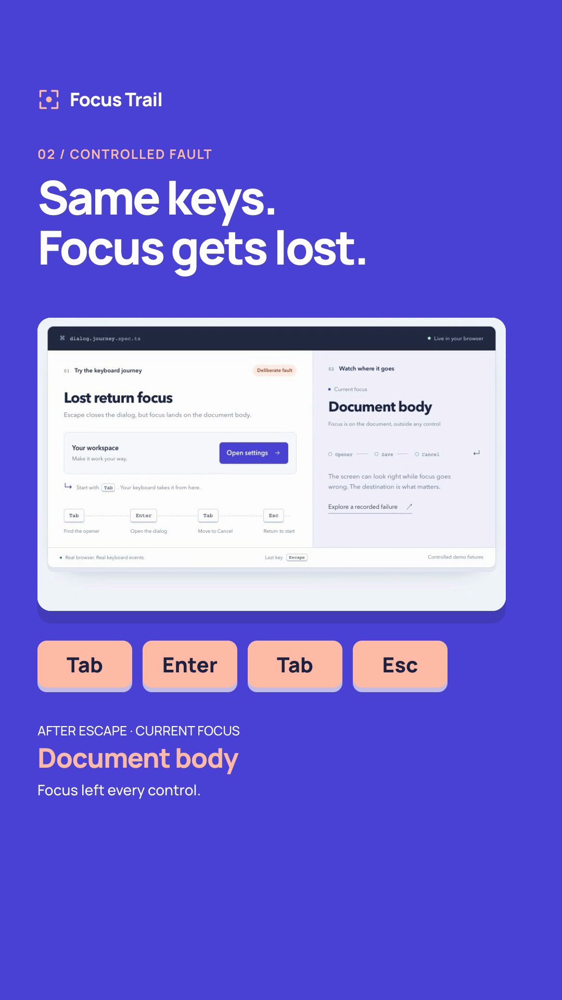
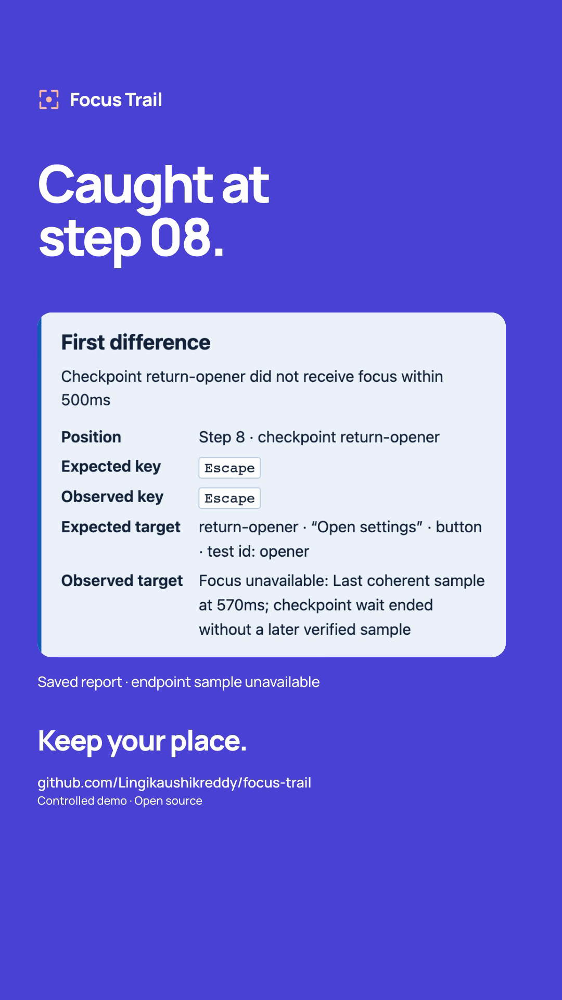
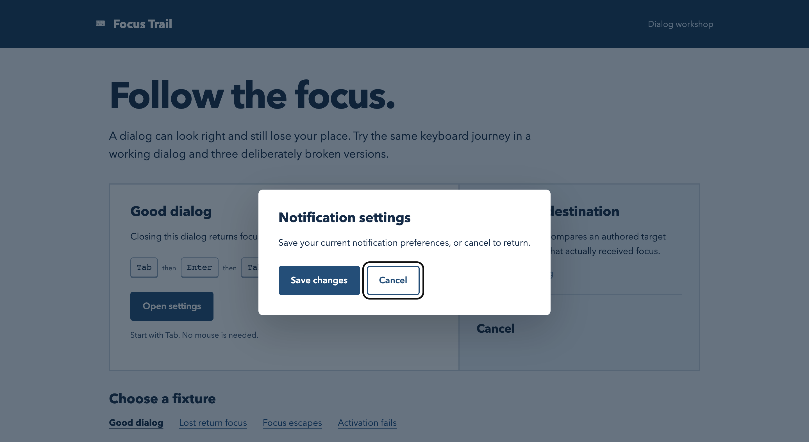
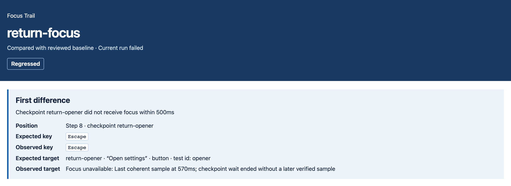
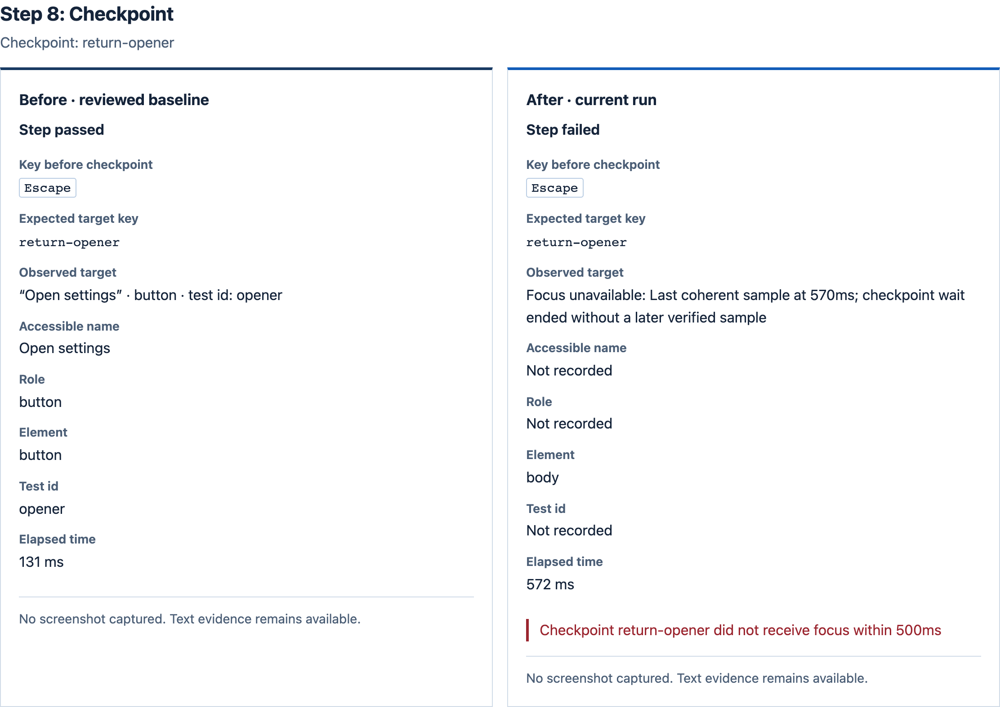

# Focus Trail

**Review keyboard focus changes from real Playwright keypresses.**

Focus Trail adds authored focus checkpoints to an existing Playwright test, records what received focus, and compares the journey with a reviewed passing baseline. Its portable HTML report identifies the first changed checkpoint or failed run.

[Reel](#watch-the-keyboard-demo) · [Quickstart](#quickstart) · [Demo](#run-the-demo) · [Reports](#example-reports) · [Pilot kit](#five-maintainer-pilot) · [Verification](#verification)

> **Pilot candidate · v0.1.0**
>
> Engineering qualification passed. Human evidence: **0/5 maintainer assessments · 0/3 independent installations**. Public npm release remains pending. [Measured status](pilot/operator/status.json)



## What it does

- Sends real keyboard actions and waits for an authored, unique focus target.
- Records computed accessible role/name, element tag and optional test ID.
- Compares the action/checkpoint contract with a passing baseline you reviewed.
- Produces an offline, keyboard-navigable HTML report and JSON evidence.
- Preserves failures from ordinary application assertions, including after early finalization.

The MVP covers one page's main document in Chromium. It supports Tab, Shift+Tab, Enter, Space, Escape and arrow keys, with bounded actions/checkpoints and duration. It records text by default and writes locally. [Scope, privacy and limits](docs/limits.md)

## Watch the keyboard demo

A **20-second portrait Reel with English AI voiceover** shows the new UI and real **Tab → Enter → Tab → Escape** interactions. The working dialog returns focus to **Open settings**; the controlled bug leaves it on **Document body**. The saved report identifies the failed `return-opener` checkpoint at Step 8.

<a href="social/reel/focus-trail-instagram-reel.mp4"></a>

**[Watch/download the Reel](social/reel/focus-trail-instagram-reel.mp4)** · [Post caption](social/reel/caption.txt)

<p>
  
  
</p>

[Editable source](social/reel/source/) · [Complete Reel kit ZIP](social/reel/focus-trail-instagram-kit.zip) · [Capture, voice and render verification](evidence/reel/README.md)

The report preserves its historical sample and marks a fresh endpoint sample unavailable. The separate browser recording verifies the demo's final focus state. GitHub may open the MP4 as a download; the cover links to the video file.

## Quickstart

Use **Node 24** (qualified on 24.22.0), **Playwright 1.64.1**, and its **full Chromium channel**. Download the [frozen candidate](distribution/focus-trail-0.1.0.tgz) and install that local file in your existing Playwright repository:

```sh
npm install --save-dev --save-exact /absolute/path/to/focus-trail-0.1.0.tgz @playwright/test@1.64.1
npx --no-install playwright install chromium
```

Keep your actual application startup, `baseURL`, authentication and required setup projects. Add these options to the selected Chromium project and configure the reporter:

```ts
import { defineConfig } from '@playwright/test';

export default defineConfig({
  use: {
    browserName: 'chromium', channel: 'chromium',
    viewport: { width: 1280, height: 800 }, locale: 'en-US',
  },
  reporter: [
    ['list'],
    ['focus-trail/reporter', {
      baselineDir: './focus-trail-baselines',
      outputDir: './focus-trail-reports',
    }],
  ],
});
```

Use the public fixture in a standard `page` test. This example targets the included local demo; adapt the route and unique locators to your own application:

```ts
import { expect } from '@playwright/test';
import { test } from 'focus-trail';

test('dialog returns focus', async ({ page, journey }, testInfo) => {
  await page.goto('http://127.0.0.1:49371/?variant=good');
  const trail = journey(page, testInfo, {
    journeyId: 'settings.dialog', fixtureVersion: 'settings-v1',
    checkpointTimeoutMs: 1000,
  });

  await trail.press('Tab');
  await trail.expectFocus('opener', page.getByTestId('opener'));
  await trail.press('Enter');
  await expect(page.getByRole('dialog')).toBeVisible();
  await trail.expectFocus('initial-target', page.getByTestId('save'));
  await trail.press('Escape');
  await expect(page.getByRole('dialog')).toBeHidden();
  await trail.expectFocus('closed-target', page.getByTestId('opener'));
  expect((await trail.finish()).status).toBe('passed');
});
```

Run your selected test and open the reporter index. The first passing capture is **review pending**. Review the intended sequence, locators, application assertions and sensitive text before [recording a baseline](docs/baseline-review.md). Baselines are never accepted or updated automatically. Replacing a repository's custom `test` import may remove its fixtures; see [the integration guide](pilot/participant-kit/START-HERE.md).

After extracting raw captures, compare directly:

```sh
npx --no-install focus-trail compare baseline.json current.json --out report.html
```

CLI exits: **0** unchanged · **1** regression · **2** invalid input/tool error · **3** incompatible metadata. [Complete API](docs/quickstart.md)

## Run the demo

From a checkout:

```sh
git clone https://github.com/Lingikaushikreddy/focus-trail.git
cd focus-trail
npm ci
npm run build
npm run demo
```

Open **http://127.0.0.1:49371**. The responsive demo includes a live focus inspector, a working dialog and controlled return-focus, modal-containment and activation faults. Start with **Tab**, then follow the displayed keys and explore the linked reports. The server also serves the checked-in reports; no browser download is needed just to view them.

<details>
<summary>See the keyboard dialog and frontend verification</summary>



[Desktop/mobile pictures and browser verification](evidence/frontend/README.md): 16 UI checks, ten viewport widths, headline checks at 17 widths, all six fixture behaviors and no external asset requests.

</details>

Sharing the project? Download the [two-image portrait post kit](social/focus-trail-instagram.zip), including 1080 × 1350 PNGs, a caption and alt text. [Preview and regenerate the artwork](social/README.md).

To regenerate the recorded journey reports with actual browser tests:

```sh
npx --no-install playwright install chromium
npm run demo:record
```

## Example reports



The screenshot shows a real controlled run: `return-opener` did not receive focus within 500 ms. The report retains a historical sample and explicitly says a later verified focus sample was unavailable; it does not claim a fresh endpoint measurement.

| Fixture | Result | HTML report | JSON evidence |
| --- | --- | --- | --- |
| Working keyboard journey | Unchanged | [Open/download](evidence/demo/good.html) | [Capture](evidence/demo/good.json) |
| Lost return focus | Regressed | [Open/download](evidence/demo/lost-return.html) | [Report data](evidence/demo/lost-return.json) |
| Focus escapes the modal | Regressed | [Open/download](evidence/demo/escape.html) | [Report data](evidence/demo/escape.json) |
| Activation assertion fails | Regressed | [Open/download](evidence/demo/activation.html) | [Report data](evidence/demo/activation.json) |

GitHub displays HTML as source. Download an HTML file and open it locally, or view it through the demo server. [Readable report summaries](docs/reports.md) describe the findings directly on GitHub.

<details>
<summary>See the before/after checkpoint evidence</summary>



</details>

## Five-maintainer pilot

The complete [pilot kit](pilot/README.md) is checked in: a frozen installer, forwarding invitation, installation guide, matched A/B task packets, sealed operator key, session protocol, receipts and conservative scoring.

1. Forward the [invitation](pilot/participant-kit/INVITATION.txt).
2. Send the [participant ZIP](pilot/focus-trail-pilot-participant-kit.zip) to confirmed volunteers.
3. Use the [40-minute session guide](pilot/operator/session-guide.md) and assigned task attachments.
4. Confirm sanitized receipts, then run `node operator/score.mjs receipts/` from `pilot/`.

Count actual human installations in distinct maintained repositories and environments. Synthetic demos and automated package consumers are engineering evidence. Keep the operator key and whole repository away from participants until their paired tasks finish; send only the assigned kit/task files.

| Gate | Current evidence |
| --- | --- |
| Five maintainer assessments | 0/5 |
| Independent successful installations | 0/3 |
| Day-14 working integrations | Pending |
| Paired diagnostic benefit and baseline decisions | Pending |
| Keyboard-user report assessment | Pending, recorded separately |

## Verification

| Evidence | Measured result | Record |
| --- | --- | --- |
| Source unit/integration/report tests | 156 passed | [Qualification summary](evidence/summary.json) |
| Repeated browser qualification | 80 runs, zero failures | [Repeat log](evidence/repeat-verification.log) |
| Frozen packed consumer | 56 checks passed | [Package receipt](evidence/package/verification.json) |
| Pilot helper and accounting | 37 checks passed | [Pilot verification](pilot/operator/verification-summary.json) |
| Paired task artifacts | 6 authentic traces; 4 offline reports | [Task verification](pilot/operator/task-verification.json) |
| Source-derived framework defect | Before fails; after passes | [Upstream reproduction](evidence/upstream/README.md) |

[Latest GitHub delivery verification](evidence/github/verification.json) reran all 156 source/browser tests, 56 packed-consumer checks and 37 pilot checks, with zero reported dependency-audit findings. [Verification notes](evidence/github/README.md)

Primary logs, reports, JSON, screenshots, preserved failed investigations and independent review notes are under [`evidence/`](evidence/) and [`pilot/operator/verification/`](pilot/operator/verification/). Historical receipts retain their original execution paths; current scripts use repository-local scratch storage.

```sh
npm ci
npx --no-install playwright install chromium
npm run verify
```

`verify` builds the checkout, runs source/browser tests and packs it into a clean consumer. It refreshes `evidence/package/`; the original human-pilot candidate remains preserved in `distribution/` and the participant kit. CI verifies the source; the manual qualification workflow does not publish. [Contributing](CONTRIBUTING.md) · [Coverage and limits](docs/qualification.md) · [Provenance](docs/provenance.md)

## Repository map

| Path | Contents |
| --- | --- |
| `packages/` | Capture/journey/comparison core, reporter and CLI |
| `examples/dialog/` | Working keyboard demo and controlled faults |
| `docs/` | API, baseline review, limits, report summaries and pictures |
| `distribution/` | Frozen installer, checksum and qualified source archive |
| `pilot/` | Participant kit, task attachments, operator protocol and receipts |
| `social/` | Portrait post artwork, narrated Reel, editable video source and sharing kits |
| `evidence/` | Engineering qualification, reports and primary evidence |
| `tests/` | Unit, browser integration and report checks |

## License

[MIT](LICENSE). Adapted upstream source snapshots retain their original [license](evidence/upstream/source/upstream/LICENSE) and [provenance](docs/provenance.md).
