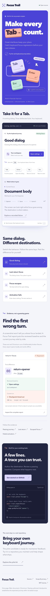

# Frontend verification

The demo introduces Focus Trail through dimensional keyboard artwork, a working keyboard journey, a live focus inspector, a recorded regression and a small integration example. The visual direction uses cobalt, peach, lilac and mint. The key artwork responds to actual keypresses. It requires no external fonts, images, scripts or additional runtime dependencies.

## Browser evidence

The [browser receipt](browser-verification.json) records source hashes, screenshot hashes, Chromium version, viewport measurements and **16 passed UI checks**. The browser used the pinned full Chromium channel at a device scale factor of 2. Desktop, mobile and the opened dialog were visually reviewed after capture.

| Check | Result |
| --- | --- |
| Responsive layout | No horizontal overflow at 320, 375, 390, 430, 650, 768, 1000, 1024, 1440 and 1920 px |
| Headline layout | The two-line headline stays intact at 17 widths, including both sides of layout breakpoints |
| Good dialog | First Tab reaches opener; Enter opens; Tab and Shift+Tab wrap; Escape and Save return focus |
| Deliberate faults | Lost return reaches body; containment fault reaches the outside link; activation leaves dialog closed |
| Other controls | Delayed initial focus and removed opener with authored alternate destination still work |
| Inspector | Shows actual focused control, active path node and concise labels for report links |
| Key feedback | Illustration and key echo follow real Tab, Enter and Escape events |
| Reports | Four HTTP 200 responses; keyboard opens the regression report at Step 8 |
| Small screens | Save remains reachable at 320×568 and 667×375; mobile headings retain word spacing |
| Preferences and runtime | Reduced motion disables transitions; zero browser script errors or external asset requests |

The full [source verification](source-verify.log) passed lint, build, type checking, **114 unit + 34 browser integration + 8 report tests = 156**, and **56 packed-consumer checks** in an isolated source copy. A separate [demo recording](demo-record.log) reproduced three passing journeys and detected all three intentional failures. Historical reports and frozen archives were preserved.

The [portrait post kit](../../social/README.md) includes two rendered still images, a caption, alt text and a manifest with source hashes and verified PNG dimensions. The report preview retains the recorded controlled-fixture disclosure and the unavailable fresh-sample note.

## Mobile view

Open the 390 px mobile capture

## Reproduce

Use Node 24, install the lockfile dependencies and full Chromium, then run `npm run demo`. Start with Tab and follow the displayed keys in each fixture. Run `npm run verify` and `npm run demo:record` in a disposable source copy to refresh engineering evidence without replacing the historical records. The UI browser-check script used for this capture is [preserved here](verify-ui.mjs); run it from any directory after starting the demo.

The previous design and its 14-check [path portability run](space-path-verification.log) remain available in Git history at `f611663`. The current receipt and pictures reflect the cobalt/keycap redesign.

The four frozen pilot tarballs retain SHA-256 `79bac5b64c1f96e7cb684e4bb746cc37af4bda902f719590bacc3984fb8e67e4`. Their packaged workshop retains the earlier design; this redesign belongs to the current source checkout. These checks do not count as a maintainer installation, a human keyboard-user assessment or a public npm release.
